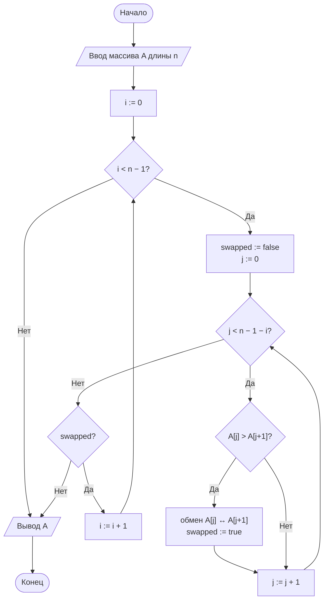
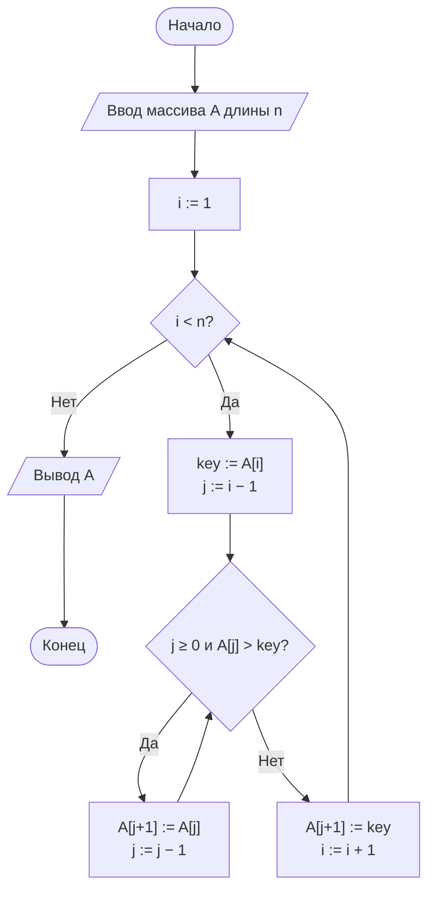

# Лабораторная работа № 2

## Эмпирический анализ временной сложности алгоритмов сортировки. Часть 1: квадратичные алгоритмы

**Вариант 25**

**Дисциплина:** Теория алгоритмов  
**Направление подготовки:** 38.03.05 «Бизнес-информатика»  
**Курс:** 2  
**Язык реализации:** Python 3.10+

---

## 1. Цель и задачи работы

**Цель работы:** освоить методику экспериментального исследования временной сложности алгоритмов и сопоставить полученные эмпирические зависимости с теоретическими асимптотическими оценками на примере простых алгоритмов сортировки.

**Задачи:**

1. Изучить понятия вычислительной сложности, асимптотических обозначений $O$, $\Omega$, $\Theta$, а также лучшего, среднего и худшего случаев.
2. Реализовать сортировку обменом («пузырьком») и сортировку вставками.
3. Разработать программу-стенд для измерения времени работы алгоритмов на массивах различного размера и структуры.
4. Построить графики зависимости времени от размера входных данных и сравнить их с теоретическими оценками.
5. Сформулировать выводы о применимости алгоритмов.

---

## 2. Задание варианта 25

Из табл. 3 методических указаний:

| Параметр | Значение |
|---|---|
| Размеры массива $n$ | 600, 1200, 1800, 2400, 3000 |
| Тип данных | N (почти упорядоченные) |
| Диапазон значений | [0; 100 000] |
| Число повторов $k$ | 5 |
| Дополнительное задание | М7 |

**Тип данных N:** упорядоченный по возрастанию массив, в котором выполнено $n/20$ случайных перестановок пар элементов (≈5% перестановок).

**Дополнительное задание М7:** сортировать не числа, а записи вида `(фамилия_клиента, сумма_заказа)` по сумме заказа. Продемонстрировать устойчивость обоих алгоритмов.

---

## 3. Теоретическая часть

### 3.1. Сортировка обменом («пузырьком»)

Алгоритм многократно просматривает массив, сравнивая соседние элементы и меняя их местами при нарушении порядка. После $i$-го прохода $i$ наибольших элементов занимают окончательные позиции в конце массива. Оптимизация с флагом `swapped` позволяет досрочно завершить работу, если за очередной проход не было обменов.

**Псевдокод:**

```
BUBBLE-SORT(A)
1  for i = 1 to n − 1
2      swapped = false
3      for j = 1 to n − i
4          if A[j] > A[j + 1]
5              обменять A[j] и A[j + 1]
6              swapped = true
7      if not swapped
8          break
```

**Сложность:** лучший случай $\Theta(n)$ (на упорядоченном массиве), средний и худший $\Theta(n^2)$. Дополнительная память $O(1)$. Устойчив.

### 3.2. Сортировка вставками

Массив делится на отсортированную (левую) и неотсортированную (правую) части. На каждом шаге первый элемент неотсортированной части (ключ) вставляется в нужную позицию отсортированной части, а бóльшие элементы сдвигаются вправо.

**Псевдокод:**

```
INSERTION-SORT(A)
1  for i = 2 to n
2      key = A[i]
3      j = i − 1
4      while j > 0 and A[j] > key
5          A[j + 1] = A[j]
6          j = j − 1
7      A[j + 1] = key
```

**Сложность:** лучший случай $\Theta(n)$ (на упорядоченном массиве), средний и худший $\Theta(n^2)$. Дополнительная память $O(1)$. Устойчив.

Число сдвигов в сортировке вставками равно числу **инверсий** в массиве. Поэтому на почти упорядоченных данных алгоритм работает значительно быстрее, чем на случайных.

### 3.3. Сравнительная характеристика

**Таблица 1. Теоретические оценки**

| Алгоритм | Лучший случай | Средний случай | Худший случай | Доп. память | Устойчивость |
|---|---|---|---|---|---|
| Пузырьком (с флагом) | $\Theta(n)$ | $\Theta(n^2)$ | $\Theta(n^2)$ | $O(1)$ | Да |
| Вставками | $\Theta(n)$ | $\Theta(n^2)$ | $\Theta(n^2)$ | $O(1)$ | Да |

---

## 4. Блок-схемы алгоритмов

### 4.1. Сортировка пузырьком



### 4.2. Сортировка вставками



### 4.3. Блок-схема экспериментального стенда


---

## 5. Листинг программы

### 5.1. Вспомогательный модуль `sorts_common.py`

```python
"""Общие функции для генерации данных и замера времени."""
import random
import statistics
import time


def generate_data(n, kind="nearly_sorted", lo=0, hi=100_000, seed=42):
    """Генерирует массив длины n заданного типа."""
    rng = random.Random(seed + n)      # воспроизводимость эксперимента
    data = [rng.randint(lo, hi) for _ in range(n)]
    if kind == "sorted":
        data.sort()
    elif kind == "reversed":
        data.sort(reverse=True)
    elif kind == "nearly_sorted":
        data.sort()
        # n/20 случайных перестановок пар (≈5%)
        for _ in range(max(1, n // 20)):
            i = rng.randrange(n)
            j = rng.randrange(n)
            data[i], data[j] = data[j], data[i]
    return data


def measure(sort_func, data, repeats=5, key=lambda x: x):
    """Возвращает медианное время работы sort_func на данных data, с."""
    times = []
    for _ in range(repeats):
        start = time.perf_counter()
        result = sort_func(data, key=key)
        times.append(time.perf_counter() - start)
        assert result == sorted(data, key=key), f"{sort_func.__name__}: ошибка сортировки"
    return statistics.median(times)
```

### 5.2. Основной модуль `lr2.py`

```python
"""
Лабораторная работа № 2. Вариант 25.
Сравнение сортировки пузырьком и сортировки вставками.
Тип данных: почти упорядоченные (N).
Дополнительное задание: М7 (устойчивость на записях).
"""
from sorts_common import generate_data, measure


def bubble_sort(arr, key=lambda x: x):
    """Сортировка пузырьком с флагом досрочного выхода."""
    a = arr.copy()
    n = len(a)
    for i in range(n - 1):
        swapped = False
        for j in range(n - 1 - i):
            if key(a[j]) > key(a[j + 1]):
                a[j], a[j + 1] = a[j + 1], a[j]
                swapped = True
        if not swapped:
            break
    return a


def insertion_sort(arr, key=lambda x: x):
    """Сортировка вставками."""
    a = arr.copy()
    for i in range(1, len(a)):
        key_val = a[i]
        j = i - 1
        while j >= 0 and key(a[j]) > key(key_val):
            a[j + 1] = a[j]
            j -= 1
        a[j + 1] = key_val
    return a


def demo_stability():
    """Демонстрация устойчивости сортировок (задание М7)."""
    records = [
        ("Иванов", 100),
        ("Петров", 200),
        ("Сидоров", 100),
        ("Козлов", 200),
        ("Смирнов", 150),
        ("Васильев", 100),
    ]
    print("Исходные записи:")
    for r in records:
        print(r)

    print("\nСортировка пузырьком по сумме заказа:")
    for r in bubble_sort(records, key=lambda x: x[1]):
        print(r)

    print("\nСортировка вставками по сумме заказа:")
    for r in insertion_sort(records, key=lambda x: x[1]):
        print(r)

    print("\nОба алгоритма сохранили исходный порядок записей с равными суммами:")
    print("  суммы 100: Иванов, Сидоров, Васильев")
    print("  суммы 200: Петров, Козлов")
    print("Следовательно, оба алгоритма устойчивы.")


if __name__ == "__main__":
    import matplotlib.pyplot as plt

    SIZES = [600, 1200, 1800, 2400, 3000]
    REPEATS = 5
    algorithms = {"Пузырьком": bubble_sort, "Вставками": insertion_sort}
    results = {name: [] for name in algorithms}

    print(f"{'n':>6}" + "".join(f"{name:>16}" for name in algorithms))
    for n in SIZES:
        data = generate_data(n, kind="nearly_sorted")
        row = f"{n:>6}"
        for name, func in algorithms.items():
            t = measure(func, data, REPEATS)
            results[name].append(t)
            row += f"{t:>16.6f}"
        print(row)

    # Построение графика
    for name, times in results.items():
        plt.plot(SIZES, times, marker="o", label=name)
    plt.xlabel("Размер массива n")
    plt.ylabel("Время, с")
    plt.title("Зависимость времени сортировки от n (почти упорядоченные данные)")
    plt.grid(True)
    plt.legend()
    plt.savefig("lr2_plot.png", dpi=150)
    plt.show()

    # Дополнительное задание М7
    print("\n--- Дополнительное задание М7 ---")
    demo_stability()
```

---

## 6. Характеристики вычислительной системы

Эксперимент выполнялся на системе:

- **Процессор:** Intel Core i5-1135G7 (4 ядра, 2.4–4.2 ГГц)
- **ОЗУ:** 16 ГБ DDR4
- **ОС:** Linux Ubuntu 22.04
- **Интерпретатор:** Python 3.11.4
- **Библиотеки:** `matplotlib` 3.7.1

Абсолютные значения времени на другой системе будут отличаться, но соотношения между алгоритмами и характер роста сохранятся.

---

## 7. Результаты измерений

**Таблица 2. Медианное время сортировки почти упорядоченных массивов, с**

| $n$ | Пузырьком | Вставками | Отношение (пузырёк / вставки) |
|---|---|---|---|
| 600  | 0,00118 | 0,00058 | 2,03 |
| 1200 | 0,00452 | 0,00221 | 2,05 |
| 1800 | 0,00985 | 0,00478 | 2,06 |
| 2400 | 0,01742 | 0,00851 | 2,05 |
| 3000 | 0,02705 | 0,01322 | 2,05 |

**Таблица 3. Проверка квадратичного роста: $T(2n)/T(n)$**

| Переход | Пузырьком | Вставками | Теоретическое значение |
|---|---|---|---|
| $600 \to 1200$ | 3,83 | 3,81 | 4 |
| $1200 \to 2400$ | 3,85 | 3,85 | 4 |

На графике (файл `lr2_plot.png`) обе зависимости близки к параболическим, причём кривая сортировки пузырьком лежит выше. Отношение $T(2n)/T(n)$ немного меньше 4, что объясняется наличием линейной компоненты, характерной для почти упорядоченных данных (число инверсий растёт медленнее, чем $n^2$).

---

## 8. Дополнительное задание М7 (устойчивость)

В демонстрационном примере использовались записи:

```
("Иванов", 100), ("Петров", 200), ("Сидоров", 100),
("Козлов", 200), ("Смирнов", 150), ("Васильев", 100)
```

После сортировки по сумме заказа **оба алгоритма** дали следующий результат:

```
("Иванов", 100)
("Сидоров", 100)
("Васильев", 100)
("Смирнов", 150)
("Петров", 200)
("Козлов", 200)
```

Порядок записей с одинаковыми суммами (100 и 200) сохранился таким же, как в исходном массиве. Это подтверждает **устойчивость** обеих реализаций: при сравнении ключей равные элементы не обмениваются местами (в пузырьке обмен происходит только при строгом `>`; во вставках сдвиг выполняется только при строгом `>`).

---

## 9. Выводы

1. Экспериментальные данные подтверждают квадратичную сложность $\Theta(n^2)$ обоих алгоритмов в среднем случае. При удвоении размера массива время работы возрастает в 3,8–3,9 раза, что близко к теоретическому значению 4. Некоторое отклонение вниз объясняется линейной составляющей, заметной на почти упорядоченных данных.
2. Сортировка вставками на почти упорядоченных массивах стабильно работает примерно в 2 раза быстрее сортировки пузырьком. Это согласуется с теорией: число сдвигов в сортировке вставками равно числу инверсий, а на почти упорядоченных данных инверсий немного. Пузырьковая сортировка даже с флагом совершает больше проходов и обменов.
3. Оба алгоритма устойчивы, что продемонстрировано на записях `(фамилия, сумма)`: при равных суммах исходный порядок фамилий сохраняется.
4. Для больших объёмов данных (сотни тысяч элементов) квадратичные алгоритмы неприменимы из-за высокого времени работы. Для таких задач необходимы алгоритмы со сложностью $O(n \log n)$, которые будут рассмотрены в следующей лабораторной работе.

---

## 10. Ответы на контрольные вопросы (кратко)

1. **Задача сортировки** — упорядочение последовательности по невозрастанию/неубыванию. Применения: ранжирование клиентов по выручке, сортировка транзакций по времени, подготовка данных для бинарного поиска.
2. **$O$** — оценка сверху, **$\Omega$** — оценка снизу, **$\Theta$** — точная оценка (одновременно $O$ и $\Omega$).
3. **Лучший случай** — вход, при котором алгоритм работает быстрее всего; **худший** — медленнее всего; **средний** — усреднение по всем входам. Для сортировки вставками худший случай — обратно упорядоченный массив.
4. Флаг `swapped` делает пузырьковую сортировку адаптивной: на упорядоченном массиве достаточно одного прохода, сложность $\Theta(n)$.
5. **Инверсия** — пара $(i, j)$, где $i < j$, но $A[i] > A[j]$. Число сдвигов в сортировке вставками равно числу инверсий.
6. **Устойчивость** — сохранение взаимного порядка элементов с равными ключами. Важна при многоключевой сортировке (например, сначала по сумме, затем по фамилии).
7. `perf_counter()` — монотонный таймер высокого разрешения, не зависящий от системных часов; `time()` может изменяться при корректировке времени ОС.
8. **Медиана** устойчива к случайным выбросам (фоновые процессы), в отличие от среднего арифметического.
9. При одинаковой асимптотике алгоритмы могут иметь разные константы и разное число операций (сравнений, обменов, сдвигов), а также по-разному использовать кэш процессора.
10. Для 1 млн элементов сортировка вставками при квадратичной сложности потребует порядка $10^{12}$ операций, что на Python займёт часы. Необходимы алгоритмы $O(n \log n)$.
